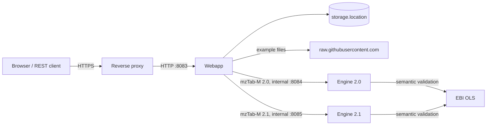

# Running your own mzTab Validator

This guide is for people who build, configure and run their own instance of the mzTab Validator web application. The public instance is at <https://apps.lifs-tools.org/mztabvalidator>.

| Guide | Contents |
|---|---|
| [Building](building.md) | Prerequisites, building and testing the JAR, building a Docker image |
| [Configuration](configuration.md) | Every setting, with its default and how to set it |
| [Operating](operating.md) | Running the JAR or the container, reverse proxy, storage and retention, memory, monitoring, upgrades, troubleshooting |

## What you run

Three Spring Boot applications (Java), each a JAR or a container image:

| Service | Image | Port | Memory | Does |
|---|---|---|---|---|
| Webapp | `lifs/mztab-validator-webapp` | 8083 | 1 GB | Serves the browser application and the REST API under `/rest/v2`, stores uploads and results below `storage.location`, and sends each file to the engine of its mzTab-M version. |
| mzTab-M 2.0 engine | `lifs/mztab-validator-engine-2.0` | 8084 | 2 GB | Validates and converts mzTab-M 2.0 with jmzTab-m 1.0.x. |
| mzTab-M 2.1 engine (optional) | `lifs/mztab-validator-engine-2.1` | 8085 | 2 GB | Validates and converts mzTab-M 2.1 with jmzTab-m 2.1.x. Not part of releases until jmzTab-m 2.1.0 is released. |

None needs a database. Only the webapp has state (files below one directory); the engines are stateless and are reached by the webapp only.



## Requirements at a glance

- **Java 24 or later** to run the JARs, or a container runtime for the images. Building also needs a JDK 24 or later and internet access (see [Building](building.md)).
- **Memory:** about 1 GB for the webapp and 2 GB per engine. See [Memory](operating.md#memory).
- **A persistent directory or volume** for the webapp's `storage.location`. Results are kept there for 7 days by default and survive restarts. The engines need none.
- **A private network between the webapp and the engines.** The engines have no authentication; only the webapp may reach them.
- **Outbound HTTPS** from the engines to the [EBI Ontology Lookup Service](https://www.ebi.ac.uk/ols4/) for semantic validation (controlled vocabulary checks), and from the webapp to `raw.githubusercontent.com` for the example files offered in the form. Structural validation works offline.
- **One webapp instance per storage directory.** Results live on the local file system of an instance; do not load-balance several.

## Quick start

From a checkout of this repository, the three JARs (see [Building](building.md) for details):

```sh
scripts/run-dev-stack.sh --build
```

Open <http://localhost:8083/mztabvalidator/>. `http://localhost:8083/mztabvalidator/actuator/health` answers `{"status":"UP",…}` once the webapp has started, and lists both engines under `engines`.

With Docker, build the images into the local Docker daemon and start them on one network:

```sh
./mvnw -B install -DskipTests
./mvnw -B -Pdocker jib:dockerBuild -pl server,engine-mztabm-2.0,engine-mztabm-2.1
docker network create mztabvalidator
docker run -d --name mztab-engine-2-0 --network mztabvalidator -m 2g \
  docker.lifs-tools.org/lifs/mztab-validator-engine-2.0:2.0.0-SNAPSHOT
docker run -d --name mztab-engine-2-1 --network mztabvalidator -m 2g \
  docker.lifs-tools.org/lifs/mztab-validator-engine-2.1:2.0.0-SNAPSHOT
docker run -d --name mztabvalidator --network mztabvalidator -p 8083:8083 -m 1g \
  -e ENGINES_MZTABM_0_LINE=2.0 -e ENGINES_MZTABM_0_URL=http://mztab-engine-2-0:8084 \
  -e ENGINES_MZTABM_1_LINE=2.1 -e ENGINES_MZTABM_1_URL=http://mztab-engine-2-1:8085 \
  -v mztabvalidator-data:/tmp/upload-dir docker.lifs-tools.org/lifs/mztab-validator-webapp:2.0.0-SNAPSHOT
```

Replace `2.0.0-SNAPSHOT` with the version you built (the `<version>` in `pom.xml`). [Operating](operating.md#running-the-containers) has the same as a compose file.
