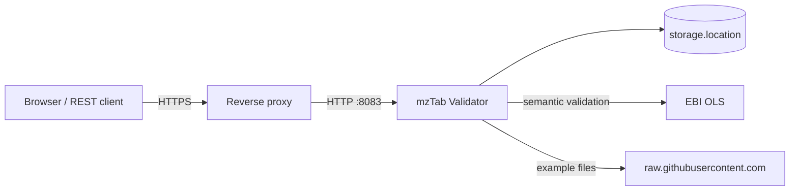

# Running your own mzTab Validator

This guide is for people who build, configure and run their own instance of the mzTab Validator web application. The public instance is at <https://apps.lifs-tools.org/mztabvalidator>.

| Guide | Contents |
|---|---|
| [Building](building.md) | Prerequisites, building and testing the JAR, building a Docker image |
| [Configuration](configuration.md) | Every setting, with its default and how to set it |
| [Operating](operating.md) | Running the JAR or the container, reverse proxy, storage and retention, memory, monitoring, upgrades, troubleshooting |

## What you run

One process: a Spring Boot application (Java) that serves the browser application and the REST API under `/rest/v2`. It needs no database. Uploads, validation results and the data shown on the result page are files below one directory (`storage.location`).



## Requirements at a glance

- **Java 24 or later** to run the JAR, or a container runtime for the image. Building also needs a JDK 24 or later and internet access (see [Building](building.md)).
- **Memory:** 1 GB is enough to try it out; the public instance runs with a 2 GB container limit. See [Memory](operating.md#memory).
- **A persistent directory or volume** for `storage.location`. Results are kept there for 7 days by default and survive restarts.
- **Outbound HTTPS** to the [EBI Ontology Lookup Service](https://www.ebi.ac.uk/ols4/) for semantic validation (controlled vocabulary checks), and to `raw.githubusercontent.com` for the example files offered in the form. Structural validation works offline.
- **One instance per storage directory.** Results live on the local file system of an instance; do not load-balance several instances.

## Quick start

With Docker, from a checkout of this repository (see [Building](building.md) for details):

```sh
./mvnw -B package -DskipTests
docker build --build-arg JAR_FILE=mztab-validator-webapp-2.0.0-SNAPSHOT.jar -t mztab-validator-webapp:local server
docker run -d --name mztabvalidator -p 8083:8083 -m 2g \
  -v mztabvalidator-data:/tmp/upload-dir mztab-validator-webapp:local
```

Open <http://localhost:8083/mztabvalidator/>. `http://localhost:8083/mztabvalidator/actuator/health` answers `{"status":"UP",…}` once the application has started.

Without Docker:

```sh
./mvnw -B package -DskipTests
java -jar server/target/mztab-validator-webapp-2.0.0-SNAPSHOT.jar --storage.location=/var/lib/mztabvalidator
```

Replace `2.0.0-SNAPSHOT` with the version you built (the `<version>` in `pom.xml`).
